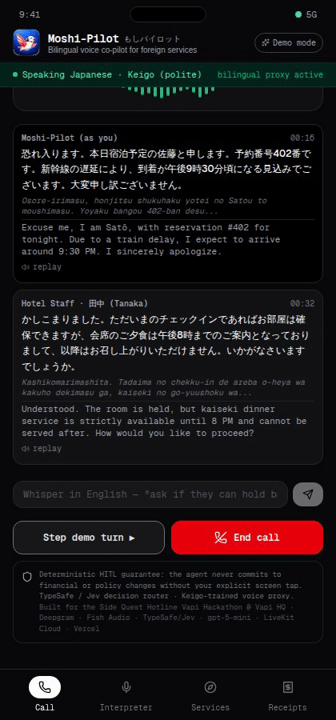
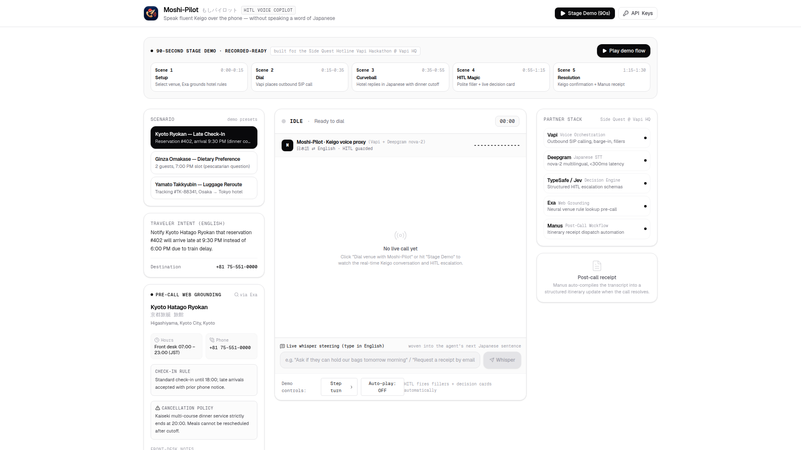
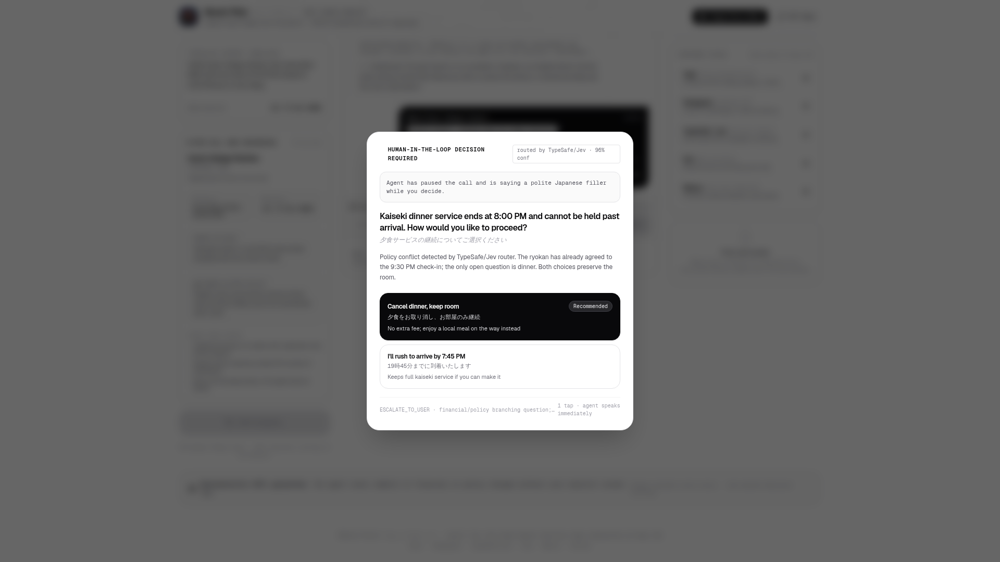
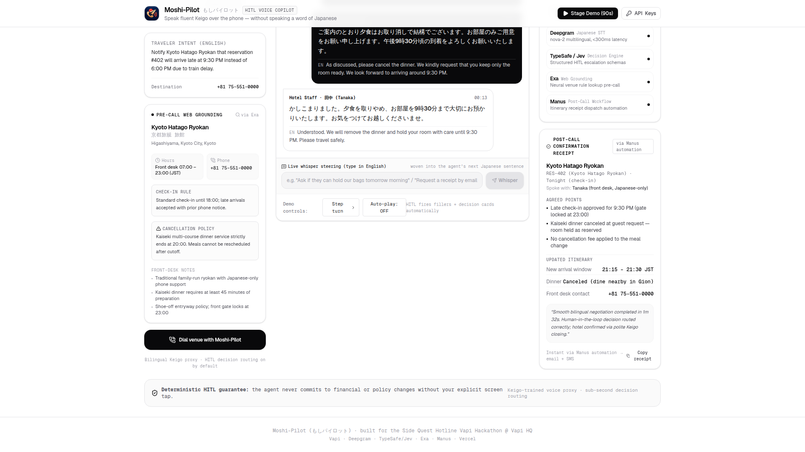

# Moshi-Pilot (もしパイロット)

**Bilingual Voice Co-pilot for Japan Travel** — speak fluent Keigo over the phone without speaking a word of Japanese.

[](https://moshi-pilot.vercel.app)
[](https://github.com/dev-ansung/moshi-pilot)
[](https://vapi.ai)
[](LICENSE)

<p align="center">
  
</p>

> Built for the **Side Quest Hotline — Vapi Hackathon @ Vapi HQ** (November 2026).
> Stack: **Vapi** (voice orchestration), **Deepgram nova-2** (Japanese STT), **TypeSafe / Jev** (deterministic HITL decision routing), **Exa** (neural pre-call web grounding), **Manus** (post-call itinerary workflow automation), **Vercel** (deployment).

---

## The Problem

Every year, 36 million people travel to Japan — and the vast majority do not speak Japanese. Japan's hospitality culture is famously phone-first: ryokans, high-end omakase restaurants, and courier services expect verbal negotiation in polite **Keigo** (敬語). When a train delay makes you miss dinner service, you have three bad options: say nothing and lose a $400 kaiseki meal, ask your concierge if you have one, or make an incomprehensible phone call.

**Moshi-Pilot solves this.** You define the traveler intent once in English. Moshi-Pilot grounds on the venue's public rules, places the call, speaks polite Keigo, and — the moment a commitment must be made — pauses the call politely, buys time with a natural Japanese filler, and pushes a translated decision card to your screen. One tap, the agent confirms in Keigo, the venue agrees, and a Manus automation compiles the entire call into a structured itinerary receipt.

---

## Demo Video (2 minutes)

The demo below is a **real end-to-end recording of the live product** — hero showcase, scenario switcher, Exa grounding, the live bilingual call with streaming transcription, the HITL decision card popup, human response, live whisper steering, and the Manus post-call receipt.

<p align="center">
  
</p>

<p align="center">
  <strong><a href="public/moshi_pilot_demo.mp4">&#x25B6; Watch the full 2-minute demo video (1080p, narrated)</a></strong>
  &nbsp;|&nbsp;
  <a href="public/moshi_pilot_demo_preview.mp4">Compressed preview (10s)</a>
</p>

Narration storyboard and scene timings live in [docs/demo_video_script.md](docs/demo_video_script.md).

---

## Screenshots

### 1. The Command Center
<p align="center"></p>

*Scenario presets for real travel friction (late check-in, dietary restrictions, luggage reroute), Exa-grounded venue facts, and one-click demo flow.*

### 2. Live Bilingual Call with Keigo
<p align="center"></p>

*Deepgram nova-2 transcribes Japanese under 300 ms; each turn shows kanji/kana, romaji, and English translation with speaker labels.*

### 3. The Human-in-the-Loop Decision Card
<p align="center"></p>

*The venue's curveball translated into English multiple-choice. While you decide, Moshi-Pilot says polite filler phrases (少々お待ちください…) so the hotel staff never hears awkward silence.*

### 4. Post-Call Confirmation Receipt
<p align="center"></p>

*Manus auto-compiles the transcript into a structured itinerary update — agreed points, updated schedule, agent summary — copyable in one click and dispatchable to email/SMS.*

---

## How It Works

```
                        Traveler intent (English)
                                   │
                                   ▼
             [Exa] Neural pre-call grounding of venue rules
                                   │
                                   ▼
          [Vapi] Outbound SIP call  ◄──►  Hotel staff (Japanese)
                                   │
                                   ▼
               [Deepgram nova-2] Japanese STT <300ms
                                   │
                         Bilingual translation
                                   │
                ┌──────────────────┴──────────────────┐
                │                                     │
         Normal turn                         Branching decision?
                │                                     │
          Agent Keigo                        [TypeSafe / Jev]
            reply                               router: confidence,
                │                              escalation schema
                │                                     │
                │                                     ▼
                │                            Polite Japanese filler
                │                            ("少々お待ちください…")
                │                                     │
                │                            HITL decision card
                │                            pushed to screen
                │                                     │
                │                               Human tap
                │                                     │
                └──────────────────┬──────────────────┘
                                   │
                                   ▼
                        Agent Keigo confirmation
                                   │
                                   ▼
             [Manus] Post-call itinerary workflow automation
             (receipt, itinerary diff, email/SMS dispatch)
```

**The deterministic HITL guarantee:** Moshi-Pilot *never* commits to financial or policy changes without your explicit screen tap. The agent can negotiate, clarify, and persuade — but the traveler holds the final say.

---

## Three Scenarios, One Engine

| Scenario | Traveler intent | Curveball | Resolution |
|----------|-----------------|-----------|------------|
| **Kyoto Ryokan — Late Check-In** | Train delay pushes check-in from 6 PM to 9:30 PM | Kaiseki dinner ends strictly at 8 PM | Human picks "Cancel dinner, keep room" — no fees, room held to 9:30 PM |
| **Ginza Omakase — Dietary Preference** | 2 guests at 7 PM want to confirm pescatarian accommodation | Restaurant needs 48-hour advance notice | Human picks chef's flexible alternative or reschedules |
| **Yamato Takkyubin — Luggage Reroute** | Forward bags (track #TK-88341) to Tokyo hotel | Delivery address change must be confirmed by sender | Human confirms address, agent speaks tracking details in Keigo |

Each scenario carries pre-grounded Exa data (hours, phone, cancellation rules, front-desk notes), authentic bilingual dialogue trees, TypeSafe/Jev decision cards, and Manus receipts.

---

## Partner Technology

| Partner | Role in Moshi-Pilot |
|---------|---------------------|
| **Vapi** | Outbound SIP telephony, voice agent orchestration, barge-in detection, and real-time filler speech delivery |
| **Deepgram** | nova-2 Japanese STT with <300 ms latency so live translation stays conversational |
| **TypeSafe / Jev** | Deterministic decision routing with strongly-typed escalation schemas; confidence scoring decides what requires human eyes |
| **Exa** | Neural pre-call web grounding — venues' public hours, policies, and phone numbers are verified before dialing |
| **Manus** | Post-call itinerary workflow automation: transcript → structured receipt → booking app/calendar/SMS dispatch |
| **Vercel** | Edge hosting with instant deployments from `git push main` |

---

## Key Differentiators

1. **Polite fillers, not silence.** Most agents go mute while deciding. Moshi-Pilot speaks natural Japanese filler phrases (*「少々お待ちください。お客様にご確認いたしております。」*) — culturally fluent and confidence-preserving.
2. **Live whisper steering.** Type instructions in English mid-call; they're woven into the agent's next Japanese sentence.
3. **Receipt-first close.** Every call ends with a structured itinerary diff, not a transcript dump.
4. **Offline-safe demo mode.** The full conversation flow runs locally with simulated waveforms and deterministic branching — stage-safe on unstable hackathon Wi-Fi, zero API keys required for presentation.

---

## Tech Stack

- **Framework:** Next.js 15 (App Router), React 19, TypeScript
- **Styling:** Tailwind CSS v4, shadcn-inspired monochrome design system
- **Icons:** Lucide React
- **Voice / STT / Orchestration:** Vapi, Deepgram nova-2
- **Decision Engine:** TypeSafe / Jev escalation schemas
- **Grounding & Workflow:** Exa (web grounding), Manus (workflow automation)
- **Deployment:** Vercel

---

## Getting Started

```bash
git clone https://github.com/dev-ansung/moshi-pilot.git
cd moshi-pilot
npm install
npm run dev
# open http://localhost:3000
```

### With real partner credentials

Copy `.env.example` to `.env.local` and fill in:

```env
VAPI_API_KEY=vapi_live_xxx
VAPI_ASSISTANT_ID=xxx
DEEPGRAM_API_KEY=xxx
EXA_API_KEY=xxx
MANUS_API_KEY=xxx
```

Without keys the app runs its built-in simulation mode — every scenario, decision card, and receipt works out of the box.

---

## Security

- No API keys are tracked in this repository (`.env*` is gitignored)
- Real credentials live in `.env.local` or the in-app API Keys modal (stored in `localStorage` in the browser only)
- Token revocation and key rotation documented in `SECURITY.md`

---

## Links

- **Live app:** [moshi-pilot.vercel.app](https://moshi-pilot.vercel.app)
- **GitHub:** [github.com/dev-ansung/moshi-pilot](https://github.com/dev-ansung/moshi-pilot)
- **Submission copy:** [docs/submission_copy.md](docs/submission_copy.md)
- **All artifacts:** [ARTIFACTS.md](ARTIFACTS.md)
- **Demo video:** [public/moshi_pilot_demo.mp4](public/moshi_pilot_demo.mp4) · [preview GIF](public/demo_preview.gif)
- **Storyboard:** [docs/demo_video_script.md](docs/demo_video_script.md)
- **Logos:** [assets/](public/assets/) (3 origami-inspired concepts)

---

## License

[MIT](LICENSE) © 2026 dev-ansung. Built for the Side Quest Hotline Vapi Hackathon @ Vapi HQ.
