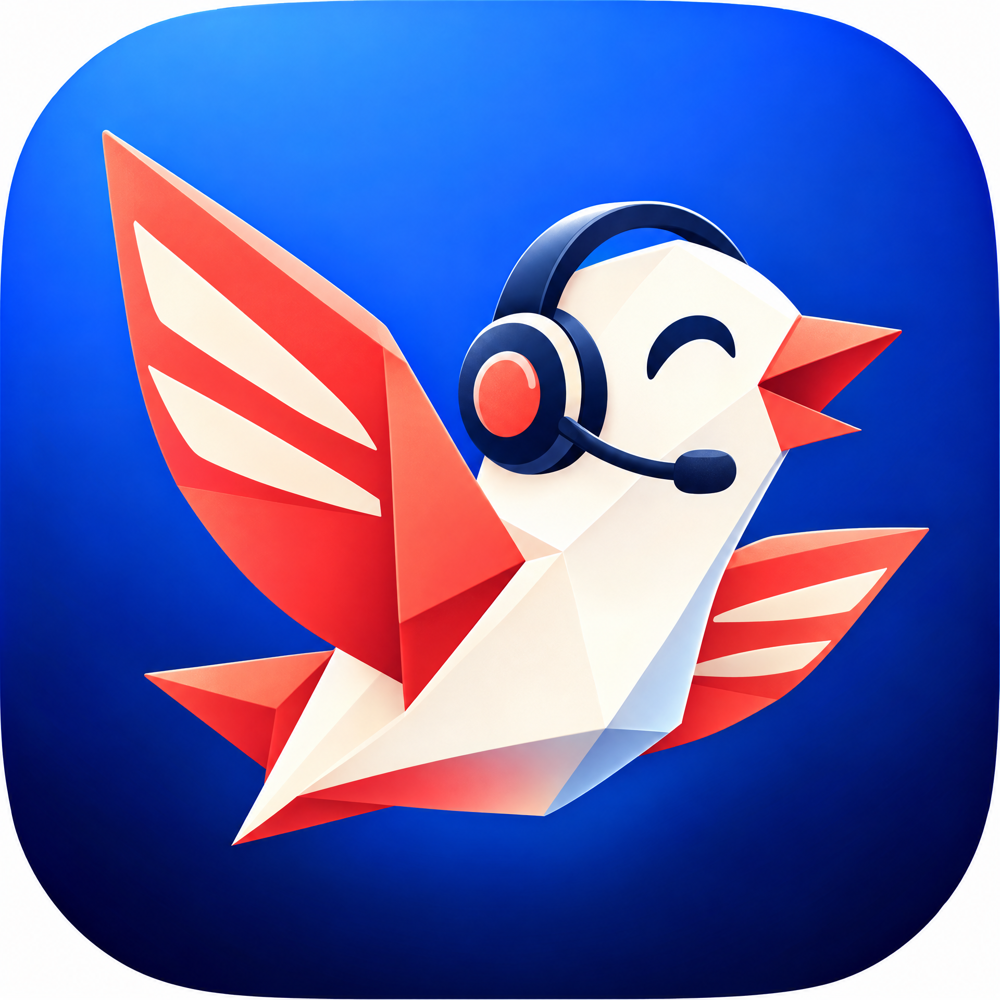
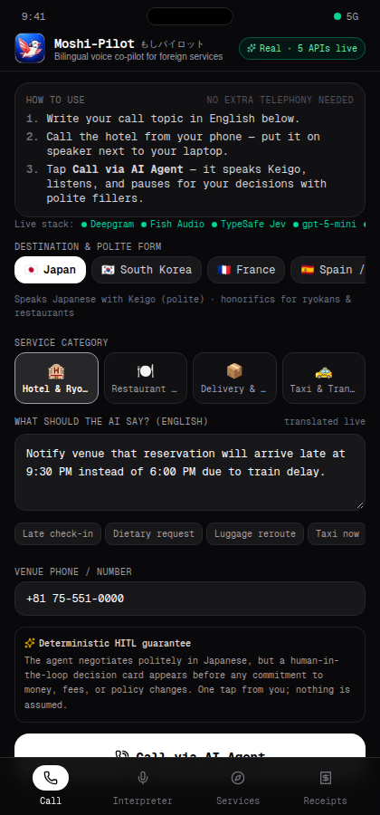
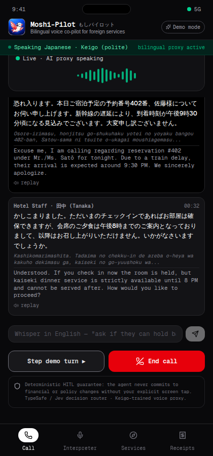
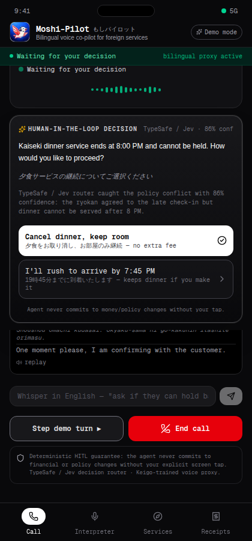
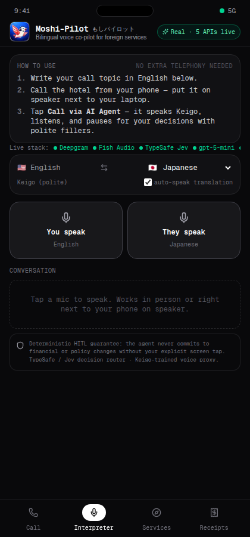
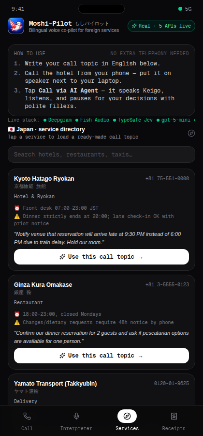
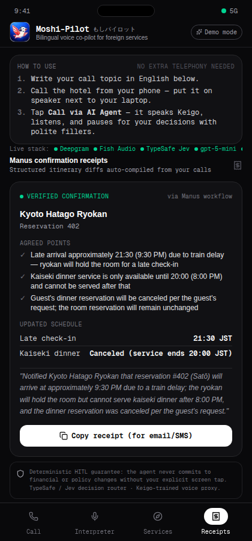

<div align="center">



# Moshi-Pilot (もしパイロット)

**The bilingual voice co-pilot for foreign services.**
You make the call from your own phone (speakerphone next to your laptop), write the topic in English, and Moshi-Pilot drives the conversation in fluent polite speech — pausing with culturally authentic filler phrases until you tap a human-in-the-loop decision card.



[](https://moshi-pilot.vercel.app)
[](https://vapi.ai)

</div>

---

## The problem

You're a foreign traveler who needs to call a Japanese ryokan, a Korean taxi, a French hotel, or a Spanish delivery service. You don't speak the language. Staff rarely speak English. Translation apps can't hold a real phone conversation. Telephony bots that commit you to fees, cancellations, or policy changes without your confirmation are **dangerous**; human interpretation services are slow, expensive, and unavailable at 10 PM.

## The solution: Moshi-Pilot

Moshi-Pilot is an **AI voice agent you run beside your phone**. No special telephony required — you call the venue from your phone, put it on speaker next to your laptop mic, and Moshi-Pilot handles the rest:

1. **Write the topic** in English — e.g. *"Late check-in notification for reservation #402, arrive 9:30 PM due to train delay"*.
2. **Call from your phone** (speakerphone on) and tap **"Call via AI Agent"**.
3. **Moshi-Pilot drives the call** in authentic polite foreign speech (Keigo for Japan, 존댓말 for Korea, *vous* for France, *usted* for Spanish speakers), listens through your microphone, translates both ways, and **pauses with polite filler phrases** whenever a decision is needed — waiting for your one-tap choice.
4. **Structured Manus receipt** auto-compiles the transcript into a verified confirmation with itinerary diffs.

## How it works



1. **You speak English** — the LLM translates into culturally correct honorific speech and **Fish Audio** speaks it through your speakers so the hotel hears it.
2. **The hotel replies in Japanese** — **Deepgram Nova-2** transcribes (<300 ms), the LLM translates into English, and the live bilingual transcript shows kanji/kana + romaji + English.
3. **A policy conflict appears** — e.g. *"Kaiseki dinner service ends strictly at 8 PM; shall we cancel dinner?"*
4. **TypeSafe / Jev evaluates the decision** and the agent plays a polite filler phrase (*"少々お待ちください…"* — *"One moment please, I am confirming with the customer"*) so there's never dead air.
5. **A translated decision card pops up** with confidence score; one tap from you, nothing assumed.
6. **Agent delivers your confirmed answer** in polite Keigo.
7. **Manus compiles a structured receipt** with agreed points and updated schedule.

---

## Product screens

| Home / topic setup | Live call + waveform | HITL decision card |
|---|---|---|
|  |  |  |

| Two-way interpreter | Service directory | Manus receipts |
|---|---|---|
|  |  |  |

---

## The stack — 5 real APIs, verified live

| Partner | Role | Verified |
|---|---|---|
| **Deepgram** | Multilingual speech-to-text (Nova-2) for the foreign speaker, <300 ms latency | HTTP 200, real transcripts |
| **Fish Audio** | Multilingual text-to-speech for polite foreign-language output (Japanese, Korean, French, Spanish, +) | HTTP 200, real audio bytes |
| **TypeSafe / Jev** | Structured System One decision engine — evaluates whether a turn needs human escalation, with confidence scores | HTTP 200, model `jev-1.14.0` |
| **gpt-5-mini** | Bidirectional translation into culturally authentic honorific registers (Keigo, *vous*, *usted*, 존댓말) + post-call receipt compilation | Live Keigo translations verified |
| **LiveKit Cloud** | Real-time WebRTC audio rooms for two-way voice streaming | JWT tokens verified |

All five are wired through server API routes (`/api/stt`, `/api/tts`, `/api/translate`, `/api/decision`, `/api/livekit-token`, `/api/receipt`) and reported live on `/api/status`.

---

## Key features

- **Speakerphone-native**: no extra phone service needed — your own phone + laptop mic
- **Country & polite-form registry**: 9+ countries with authentic filler phrases
- **Live bilingual transcript**: original language + romaji + English, speaker-labeled
- **Deterministic HITL guarantee**: zero financial/policy commitments without your explicit tap
- **Polite fillers during decisions**: culturally authentic "hold" phrases in the local language
- **Live whisper steering**: type in English mid-call; agent weaves it into the next sentence
- **Manus receipts**: structured JSON itinerary diffs compiled from real transcripts
- **Two-way interpreter tab**: in-person live voice translation
- **Service directory**: ready-made call topics per service
- **Demo mode**: offline-safe authentic dialogue for stage presentations

---

## Quick start

```bash
git clone https://github.com/dev-ansung/moshi-pilot.git
cd moshi-pilot
cp .env.example .env.local    # fill your keys
npm install
npm run dev
# open http://localhost:3000
```

Required keys for real mode: `DEEPGRAM_API_KEY`, `FISH_AUDIO_API_KEY`, `TYPESAFE_API_KEY`, `OPENAI_API_BASE`, `OPENAI_API_KEY`, `LIVEKIT_*`. Without keys the app automatically falls back to offline-safe Demo mode.

---

## Links

- **Live app**: [moshi-pilot.vercel.app](https://moshi-pilot.vercel.app)
- **Repository**: [github.com/dev-ansung/moshi-pilot](https://github.com/dev-ansung/moshi-pilot)
- **Submission copy**: [docs/submission_copy.md](docs/submission_copy.md)
- **Artifacts manifest**: [ARTIFACTS.md](ARTIFACTS.md)

Built for the **Side Quest Hotline Vapi Hackathon @ Vapi HQ**, November 9, 2026.
